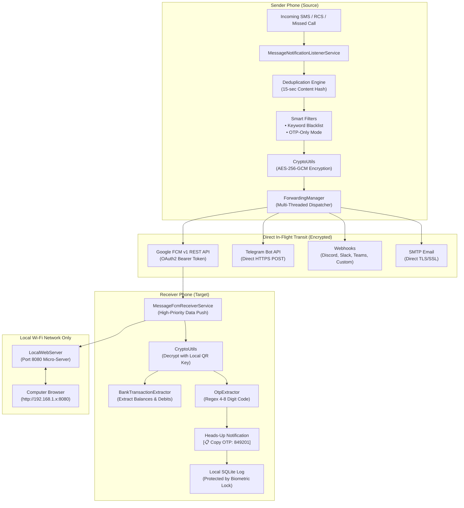

# 🏗️ Technical Architecture & Engineering Deep Dive

## 1. Architectural Philosophy: Zero-Server, Zero-Permission

Traditional SMS forwarders relied on sensitive Android permissions (`READ_SMS`, `RECEIVE_SMS`, `SEND_SMS`, `READ_CALL_LOG`). Under modern Android OS constraints and Google Play policies, this approach fails because:
1. Google Play bans apps using `RECEIVE_SMS` or `SEND_SMS` unless they are selected as the device's **Default SMS Handler**.
2. Android provides **no public API to intercept incoming RCS messages** (Rich Communication Services in Google Messages / Samsung Messages).

**RelayMate's Solution:**
* **Zero SMS Permissions**: Complete absence of `READ_SMS`, `RECEIVE_SMS`, and `SEND_SMS` in `AndroidManifest.xml`.
* **Zero Call Permissions**: Complete absence of `READ_CALL_LOG` or `PROCESS_OUTGOING_CALLS`.
* **Notification-First Interception**: Leverages Android’s sanctioned `NotificationListenerService` to capture SMS, RCS, and missed call alerts directly from the system notification tray.
* **Direct Client-to-Cloud Dispatch**: The sender device communicates directly with verified cloud APIs (Google FCM v1, Telegram Bot API, Discord/Slack webhooks, SMTP) without any intermediary developer backend or database.

---

## 2. System Architecture Flow



---

## 3. Core Technical Subsystems

### A. Notification Capture (`MessageNotificationListenerService.kt`)
* **Monitored Messaging Packages**:
  * `com.google.android.apps.messaging` (Google Messages — SMS + RCS)
  * `com.samsung.android.messaging` (Samsung Messages)
  * `com.android.mms` (AOSP Messaging)
  * Carrier messaging apps (Verizon, AT&T, T-Mobile, SMS Organizer).
* **Monitored Dialer Packages**:
  * `com.google.android.dialer`, `com.samsung.android.incallui`, `com.samsung.android.dialer`, OnePlus, Oppo, Vivo, Motorola.
* **Dual-SIM Detection**:
  * Extracts carrier/slot info from `extras.getCharSequence(Notification.EXTRA_SUB_TEXT)`, `android.substName`, or `android.slotId`.
  * Prefixes payload with `[SIM 1 • Jio]` or `[SIM 2 • Airtel]`.

### B. Client-Driven Google FCM v1 Authentication (`FcmForwardingManager.kt`)
* Google deprecated the legacy FCM server key API in favor of the **FCM HTTP v1 REST API** (`https://fcm.googleapis.com/v1/projects/{projectId}/messages:send`).
* Rather than requiring a Node.js daemon or cloud function, the Android app embeds Google's official `com.google.auth:google-auth-library-oauth2-http:1.23.0`.
* The sender phone reads `assets/service-account.json`, signs an RSA JWT locally, and requests a short-lived Google OAuth2 Bearer token (`auth/firebase.messaging`).
* Tokens are cached locally in memory and refreshed automatically upon expiration.
* **Multi-Receiver Broadcasting**: Concurrently dispatches HTTP POST payloads to up to 3 paired receiver tokens.

### C. Client-Side End-to-End Encryption (`CryptoUtils.kt`)
* **Algorithm**: `AES/GCM/NoPadding` (256-bit key size).
* **IV**: 12-byte cryptographically secure random IV generated per message (`SecureRandom`).
* **Authentication Tag**: 128-bit integrity tag.
* **Envelope Format**:
  ```json
  {
    "iv": "<Base64_IV>",
    "data": "<Base64_Ciphertext>"
  }
  ```
* **Key Exchange**: The symmetric 256-bit key is generated on the receiver device and encoded inside the pairing QR code. It is scanned physically camera-to-screen with zero internet transit.

### D. Embedded Local Web Server (`LocalWebServer.kt`)
* **Technology**: Pure Kotlin `java.net.ServerSocket` running on port `8080`.
* **Zero Dependencies**: Requires no external runtime (no Node.js, no Python, no external libraries).
* **Security**:
  * Binds strictly to the device's local Wi-Fi interface.
  * Requests require a 4-digit pairing PIN (default: `1234`, customizable in app).
* **Desktop Push Notifications & Synthesized Web Audio**:
  * Integrates browser Web Notifications API (`Notification.requestPermission()`, `new Notification()`) for native OS notification center alerts when messages or OTPs arrive.
  * Synthesizes crisp dual-tone audio chimes (587.33 Hz D5 $\rightarrow$ 880.00 Hz A5) directly via the Web Audio API (`AudioContext`), requiring zero external audio assets.
* **API Endpoints**:
  * `GET /`: Serves the responsive, dark-mode single-page HTML/CSS dashboard.
  * `GET /api/messages?pin={pin}`: Returns JSON array of recent messages, timestamps, and extracted OTPs.

### E. Financial & Bank Transaction Extraction (`BankTransactionExtractor.kt`)
* Analyzes notification text against multi-currency balance patterns:
  `/(?:avl\.?\s*bal|available\s*balance|bal)\s*[:=-]?\s*(?:inr|rs\.?|usd|\$|€|£)?\s*([0-9,]+(?:\.[0-9]{2})?)/i`
* Parses account endings (e.g., `*1234` or `XX554`) and transaction type (Debit vs Credit).
* Automatically updates the in-memory and local SharedPreferences cache.

### F. Smart OTP Isolation (`OtpExtractor.kt`)
* Regex pipeline recognizes 4-to-8 digit numeric and alphanumeric authentication codes, PINs, and passwords.
* Excludes false positives (years, phone numbers, dollar amounts, dates, and order numbers).

### G. Background Survival & OEM Watchdog (`ForwarderWatchdogService.kt`)
* Implements a persistent Android Foreground Service with `FOREGROUND_SERVICE_TYPE_DATA_SYNC`.
* Configured with `START_STICKY` so Android's `ActivityManager` restarts the process if terminated under low RAM pressure.
* Listens for `android.intent.action.BOOT_COMPLETED` via `BootReceiver.kt` to auto-launch after device reboot.

### H. Offline Dispatch Resilience & Exponential Backoff (`OfflineDispatchQueue.kt`)
* Implements an in-memory volatile queue with a `ScheduledExecutorService` timer.
* When network connectivity drops (elevators, basements, tunnels), outgoing dispatches are automatically enqueued.
* Retries automatically using exponential backoff: **5s $\rightarrow$ 15s $\rightarrow$ 45s** (maximum 3 retry attempts) as soon as data connectivity is restored.

### I. Quick Settings Notification Shade Tile (`ForwarderTileService.kt`)
* Inherits Android `TileService` (`android.service.quicksettings.TileService`).
* Provides single-tap toggling of message forwarding (`Tile.STATE_ACTIVE` $\leftrightarrow$ `Tile.STATE_INACTIVE`) directly from Android's pull-down notification shade without opening the application.

### J. Configuration Backup & Migration (`PrefsManager.kt`)
* Serializes all channel integrations, tokens, webhook endpoints, and filtering rules into a portable, versioned JSON backup payload.
* Deserializes and validates backups to restore complete configuration onto replacement devices in seconds.

### K. Freemium Hybrid Monetization & Quota Engine (`AdManager.kt` & `PrefsManager.kt`)
* **Default Free Quota**: Configured to `2` messages/day (`PrefsManager.DEFAULT_DAILY_LIMIT`). Highly configurable via `setDailyLimit(Int)`.
* **Rewarded Video Ad Replenishment**: Free users can watch a 15–30s video to immediately earn `+2` bonus message forwards for today (`PrefsManager.DEFAULT_BONUS_PER_AD`). Configurable via `setBonusPerAd(Int)`.
* **Receiver-First Monetization Strategy**: The Sender phone (source device) remains 100% silent and ad-free. When the 2-message limit is reached, Sender sends a high-priority FCM alert to the Receiver phone:
  `⚠️ Daily Quota Reached (2/2) | Tap to watch video for +2 forwards or unlock Pro`.
  The Receiver phone hosts the checkout sheet and Rewarded Video ad.
* **Pro Plan**: Instantly disables and unloads all AdMob components and unlocks unlimited forwarding.

### L. Anti-Tamper Cryptographic License Guard (`PrefsManager.kt`)
* Uses salted HMAC-SHA256 signatures computed across package name, secret compile-time seed, `isPro`, message count, daily limit, and bonus quota.
* Verified in real time on every quota read. If modified externally via root XML editors or SQLite tools, the signature check fails, resets privileges, clamps daily quota, and logs a tamper alert.

### M. Wear OS & Smartwatch Optimization (`MessageFcmReceiverService.kt`)
* Leverages Android's `NotificationCompat.WearableExtender()` with high-priority heads-up channels.
* Sets `.setContentAction(0)` to promote the interactive `[📋 Copy OTP]` action directly to the smartwatch watchface for 1-tap confirmation on Galaxy Watch and Pixel Watch devices.

### N. Two-Way Delivery Acknowledgements (`DELIVERY_ACK`)
* Implements an asynchronous confirmation protocol.
* When an encrypted message arrives over FCM on the receiver device, it dispatches an ephemeral, lightweight `DELIVERY_ACK` packet back to the sender device.
* The sender's log and diagnostic dashboard immediately verify that the payload reached the physical companion device, measuring end-to-end latency.

### O. Zero-Disk Storage Architecture (`PrefsManager.kt`)
* Offers an ultra-secure ephemeral mode for enterprise and banking users.
* When `RETENTION_ZERO_DISK` is activated, messages and extracted OTPs are relayed in RAM only; no plaintext or ciphertext payloads are written to non-volatile flash storage.

### P. Advanced Regular Expression Matching Engine (`ForwardingManager.kt`)
* Pre-evaluates incoming messages against customizable regular expressions using standard Java/Kotlin Regex engines.
* Evaluates before quota decrement or channel transmission, allowing complex filtering (e.g. `(?i)(salary|credited|refund|otp)`).

### Q. Subsystem Health Diagnostic Audit Engine (`MainActivity.kt`)
* Implements a unified health check that programmatically queries Android's `NotificationManager`, `PowerManager`, `ConnectivityManager`, `BillingClient`, and `FirebaseMessaging` APIs.
* Evaluates 8 core subsystems simultaneously, generating an actionable diagnostic report with 1-tap resolution handlers for permission or battery optimization drops.

### R. Home Screen Glance Widget Architecture (`RelayAppWidgetProvider.kt`)
* Inherits Android's `AppWidgetProvider` with custom RemoteViews layout.
* Dispatches asynchronous broadcast events:
  * `ACTION_TOGGLE_FORWARDING`: Resumes or pauses foreground watchdog and syncs with QS Tile.
  * `ACTION_COPY_OTP`: Triggers `CopyOtpReceiver` directly with masked clipboard extras.
* Auto-refreshes on every message reception, watchdog state toggle, or system boot.

### S. Remote Battery & Power-Loss Telemetry (`BatteryStatusReceiver.kt`)
* Listens for `ACTION_BATTERY_LOW`, `ACTION_BATTERY_OKAY`, `ACTION_POWER_CONNECTED`, and `ACTION_POWER_DISCONNECTED`.
* Dynamically registered inside `ForwarderWatchdogService` to guarantee receipt across Doze mode and OEM battery task-killers.
* Triggers high-priority remote alerts to companion receivers when battery falls to $\le 15\%$ or charger is disconnected while battery is $\le 25\%$, with built-in 4-hour and 1-hour anti-spam cooldowns.

### T. Wi-Fi Only Connectivity Router (`OfflineDispatchQueue.kt` & `ForwardingManager.kt`)
* Evaluates active network capabilities using `NetworkCapabilities.TRANSPORT_WIFI`.
* When Data Saver / Wi-Fi Only mode is activated, messages arriving while on cellular data bypass immediate dispatch and are enqueued into the in-memory queue.
* Automatically flushes the queue as soon as the device reconnects to a Wi-Fi access point.

### U. 60-Second Auto-Clear Security Timer (`CopyOtpReceiver.kt`)
* Implements a delayed post-processing runnable on the main looper.
* Automatically verifies whether the active clipboard content matches the copied OTP code.
* Clears primary clipboard memory using `clipboard.clearPrimaryClip()` (API 28+) or an empty plaintext clip on legacy versions, protecting authentication tokens from malicious background applications.

### V. Bidirectional Telemetry Ping Engine (`MessageFcmReceiverService.kt` & `FcmForwardingManager.kt`)
* Implements an asynchronous query-response mechanism:
  * Receiver issues `PING_REQUEST` data packets to the paired sender token.
  * Sender queries battery scale, charging plug status, active network transport, and watchdog state.
  * Dispatches an unencrypted `PING_RESPONSE` payload back to the originating receiver.
  * Receiver surfaces an on-screen telemetry modal and Android notification.

### W. Scheduled Daily Summary Digest Engine (`ForwarderWatchdogService.kt`)
* Evaluates system clock on each 1-hour watchdog interval.
* Once per day at or after 20:00 (8:00 PM), compiles a comprehensive activity digest: total relayed messages, OTP count, parsed bank alerts, missed calls, and current sender battery percentage.
* Relays report through `ForwardingManager` across all configured channels with automated daily deduplication.

### X. Dynamic Launcher Shortcuts Engine (`shortcuts.xml` & `MainActivity.kt`)
* Leverages Android's `ShortcutManager` and `<meta-data android:name="android.app.shortcuts" ... />` integration.
* Defines three static/dynamic launcher intents:
  * `com.mom.messageforwarder.ACTION_VIEW_LATEST_OTP`: Scans the message log in reverse order, extracts the newest OTP code via `OtpExtractor`, copies it directly to the clipboard with sensitive clip flags, and presents an interactive toast.
  * `com.mom.messageforwarder.ACTION_TOGGLE_RELAY`: Toggles the active forwarding state, stopping or starting `ForwarderWatchdogService` and updating UI, widgets, and Quick Settings tiles.
  * `com.mom.messageforwarder.ACTION_DIAGNOSTICS`: Instantly opens the 7-point System Diagnostics audit modal.

### Y. Smart Channel Routing Matrix (`ForwardingManager.kt` & `PrefsManager.kt`)
* Enforces content-aware security policies on outgoing payloads.
* Evaluates `prefs.isRouteOtpToFcmOnly()` and verifies whether `OtpExtractor.extractOtp(body)` matches a valid authentication code.
* If positive, the dispatch pipeline routes the message strictly to paired companion devices using client-side AES-256-GCM encrypted FCM, while skipping external public/shared webhooks (Telegram, Discord, Slack, Teams, SMTP Email).
* Non-OTP payloads (general alerts, bank spend updates, battery notices) continue to broadcast across all active destinations.

### Z. Live Ringing Call Interception Engine (`MessageNotificationListenerService.kt`)
* Detects incoming phone calls in real time while the source device is actively ringing.
* Filters for system dialer packages (`com.google.android.dialer`, Samsung dialer, OnePlus, Xiaomi) with category `NotificationCompat.CATEGORY_CALL` or ringing call titles.
* Dispatches a high-priority `msgType = "RINGING"` payload to companion devices, alerting the user immediately before the call becomes a missed call.
* Uses an in-memory 30-second deduplication timestamp map to prevent repeated ringing notification updates from triggering multiple dispatches.

### AA. Ephemeral OTP Auto-Dismiss Engine (`MessageFcmReceiverService.kt`)
* Implements a two-tier automatic dismissal mechanism for temporary verification codes:
  * **Platform Level**: Configures `notificationBuilder.setTimeoutAfter(300_000L)` on Android 8.0+ (API 26+), delegating notification dismissal to the Android OS NotificationManager.
  * **Fallback Level**: Posts a delayed runnable to the main looper (`Handler.postDelayed`) to cancel the notification ID after 5 minutes (300,000 ms).
* Ensures expired authentication codes do not linger in the receiver's notification shade.

### BB. Emergency SOS Trigger Engine (`ForwardingManager.kt` & `PrefsManager.kt`)
* Scans incoming message payloads for configurable life-safety keywords (`HELP`, `SOS`, `EMERGENCY`, `URGENT`, `FALL`, `ACCIDENT`).
* When an emergency trigger is matched:
  * Automatically sets `msgType = "EMERGENCY"`.
  * Bypasses Quiet Hours (DND), OTP-only filters, and keyword blacklists.
  * On receiver devices, triggers `RemoteRingerHelper.playEmergencyRing()` to sound an audible ringer even in Silent mode, alongside `NotificationCompat.CATEGORY_ALARM` heads-up notification in high-contrast red.

### CC. Sender Whitelist & Blacklist Matrix (`PrefsManager.kt` & `ForwardingManager.kt`)
* Evaluates sender metadata before quota consumption or dispatch.
* Supports 3 operational modes:
  * `ALL`: Relays all incoming SMS and notifications (default).
  * `WHITELIST`: Forwarding allowed strictly when sender matches configured alphanumeric tokens or phone numbers.
  * `BLACKLIST`: Drops unwanted promotional or betting shortcodes while relaying everything else.

### DD. Native iOS Receiver Companion Architecture (`ios-receiver/`)
* **Swift 5.9 & SwiftUI**: Native Apple application running on iOS 16+, iPadOS, and macOS.
* **Apple CryptoKit Interoperability**: Decrypts Android AES-256-GCM envelopes (`{"iv":"...","data":"..."}`) by unpacking the trailing 16-byte GCM authentication tag and computing `AES.GCM.open`.
* **Background Push Extension (`UNNotificationServiceExtension`)**: Intercepts silent/background APNs push notifications to decrypt ciphertexts and parse verification codes before presenting banners to the lock screen.
* **Interactive Notification Actions**: Registers `RELAYMATE_OTP` and `RELAYMATE_EMERGENCY` notification categories with 1-tap `[📋 Copy OTP]` actions.

### EE. Hybrid Dual-Role Architecture (`MODE_HYBRID`)
* Allows a single Android device to execute both Sender and Receiver roles simultaneously.
* **State Management**: When `prefs.getAppMode() == "HYBRID"`, `prefs.isSenderMode()` and `prefs.isReceiverMode()` both evaluate to `true`.
* **Watchdog Execution**: `ForwarderWatchdogService` runs in the foreground to keep the listener and local dispatch channels alive.
* **Inbound Push Decryption**: `MessageFcmReceiverService` handles incoming Google FCM pushes from paired external companion devices, rendering local notifications and bank snapshots.
* **Loop Prevention Shield**: `MessageNotificationListenerService` strictly filters out notifications where `sbn.packageName == packageName`, guaranteeing that incoming decrypted companion alerts do not trigger an accidental infinite outbound re-forward loop.

### FF. Low Device Storage Watchdog (`ForwarderWatchdogService.kt`)
* **Filesystem Introspection**: Leverages standard Linux `StatFs(Environment.getDataDirectory().path)` to compute available free internal storage without requiring any runtime permissions (`availableBlocksLong * blockSizeLong / 1024 / 1024`).
* **Threshold & Cooldown**: Evaluates storage periodically in the watchdog heartbeat runnable; if available space drops $\le 500\text{ MB}$, dispatches a high-priority `msgType = "SYSTEM"` alert to companion receivers with a 12-hour anti-spam cooldown window (`KEY_LAST_STORAGE_ALERT_TIME`).
* **OS Protection**: Prevents Android system memory managers from silently terminating foreground forwarder services due to critical disk pressure.

### GG. SIM Card Swap & Removal Security Engine (`SimStateReceiver.kt`)
* **Zero-Telephony Broadcast**: Intercepts `android.intent.action.SIM_STATE_CHANGED` via both static manifest registration and dynamic context registration in `ForwarderWatchdogService`. Does not require sensitive telephony permissions (`READ_PHONE_STATE` is absent).
* **State Detection**: Inspects the intent extra `"ss"`. When `simState == "ABSENT"`, dispatches an immediate `msgType = "SYSTEM"` alert to companion receivers warning of physical device tampering or SIM removal.
* **1-Hour Anti-Spam Cooldown**: Ensures rapid alerts without network flooding if the SIM tray is repeatedly toggled.

### HH. 1-Tap Quick Profiles Presets Engine (`MainActivity.kt` & `PrefsManager.kt`)
* **Instant Dashboard Setup**: Provides 3 atomic profiles that batch-configure preferences in 1 tap:
  * **Banking & 2FA Only**: Configures `forwardOtpOnly = true`, `routeOtpToFcmOnly = true`, `autoClearOtpClipboard = true`, `autoCopyOtp = true`, `ephemeralOtpNotif = true`, `forwardMissedCalls = false`, `forwardLiveCalls = false`.
  * **Senior Care**: Configures `forwardLiveCalls = true`, `forwardMissedCalls = true`, `lowBatteryAlert = true`, `emergencySos = true`, `biometricLock = true`, `lowStorageAlert = true`, `simSwapAlert = true`.
  * **Dual-SIM Work**: Configures `forwardLiveCalls = true`, `forwardMissedCalls = true`, `quietHoursEnabled = true` (19:00 to 08:00 with `quietHoursOtpExempt = true`), and sets default nickname to `"Work Phone"`.

### II. Remote Ringer Silencer Protocol (`MessageFcmReceiverService.kt`)
* **Zero DND-Policy Permission Audio Control**: On companion Receiver trigger, sends an FCM payload with `type = "REMOTE_MUTE"`.
* **Execution**: In `MessageFcmReceiverService.kt`, calls `audioManager.setStreamVolume(STREAM_RING, 0, 0)`, `setStreamVolume(STREAM_NOTIFICATION, 0, 0)`, and sets `ringerMode = RINGER_MODE_VIBRATE`.
* **Reliability**: Bypasses the need for dangerous `android.permission.ACCESS_NOTIFICATION_POLICY` (which requires manual user grants in system settings), providing 100% automated remote silencing across standard Android releases.


