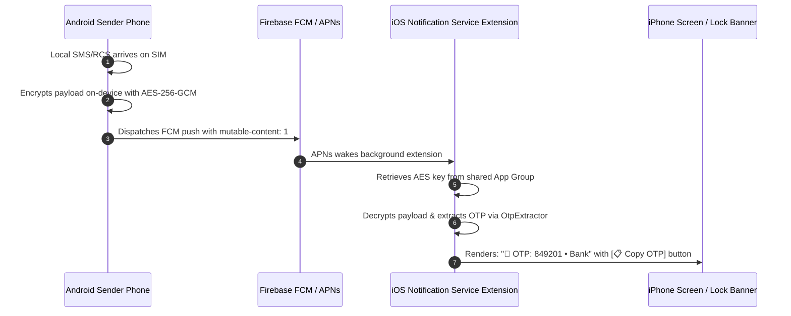

# 🍎 RelayMate iOS Receiver: Master Production Runbook

<p align="center">
  <b>Complete Guide to Building, Signing, Deploying, and Publishing the RelayMate iPhone Companion App.</b>
  <br>
  <i>Apple App Store Compliance • APNs & Firebase Cloud Messaging • CryptoKit AES-256-GCM Decryption</i>
</p>

---

## 📋 Table of Contents
1. [Architecture & Apple Compliance](#1-architecture--apple-compliance)
2. [Prerequisites](#2-prerequisites)
3. [Step 1: Apple Developer Portal Setup (App IDs & App Groups)](#step-1-apple-developer-portal-setup)
4. [Step 2: APNs Authentication Key (.p8) Generation](#step-2-apns-authentication-key-p8-generation)
5. [Step 3: Linking APNs to Firebase Console](#step-3-linking-apns-to-firebase-console)
6. [Step 4: Xcode Project & Notification Extension Setup](#step-4-xcode-project--notification-extension-setup)
7. [Step 5: End-to-End Pairing & Verification](#step-5-end-to-end-pairing--verification)
8. [Step 6: App Store Submission & Privacy Questionnaire](#step-6-app-store-submission--privacy-questionnaire)

---

## 1. Architecture & Apple Compliance

Unlike the Sender engine (which requires Android's `NotificationListenerService` and persistent foreground watchdog), the **iOS Receiver is 100% compliant with standard Apple iOS APIs**:



* **No Telephony Permissions**: Does not access cellular SIMs, calls, or SMS directly on the iPhone.
* **No Background Drain**: Uses Apple Push Notification service (APNs). The iOS app sleeps completely until a push wakes the extension.
* **Client-Side Cryptography**: Ciphertexts are decrypted in memory using Apple's `CryptoKit` framework.

---

## 2. Prerequisites

* Mac running macOS Sonoma 14+ or macOS Sequoia 15+.
* **Xcode 15+** or **Xcode 16** with iOS 17+ SDK.
* Active **Apple Developer Program** account ($99/year) for APNs capability and App Store distribution.
* Physical iPhone or iPad running iOS 16.0+ (Push notifications require physical hardware; simulators do not receive APNs remote pushes).

---

## Step 1: Apple Developer Portal Setup

Log into [developer.apple.com](https://developer.apple.com/account/) $\rightarrow$ **Certificates, Identifiers & Profiles**:

### 1. Create an App Group
An App Group allows the **Main App** and the **Notification Service Extension** to share the AES-256 encryption key and message logs:
1. Navigate to **Identifiers** $\rightarrow$ Click **+** $\rightarrow$ Select **App Groups**.
2. **Description**: `RelayMate Shared Group`
3. **Identifier**: `group.com.mom.relaymate` (or your reverse-domain prefix).
4. Click **Continue** $\rightarrow$ **Register**.

### 2. Create the Main App Identifier
1. Under **Identifiers**, click **+** $\rightarrow$ Select **App IDs** $\rightarrow$ **App**.
2. **Description**: `RelayMate Receiver`
3. **Bundle ID**: Explicit $\rightarrow$ `com.mom.relaymate.receiver`
4. Under **Capabilities**, enable:
   - ✅ **Push Notifications**
   - ✅ **App Groups** (Assign `group.com.mom.relaymate`)
5. Click **Register**.

### 3. Create the Notification Service Extension Identifier
1. Click **+** $\rightarrow$ **App IDs** $\rightarrow$ **App**.
2. **Description**: `RelayMate Notification Service Extension`
3. **Bundle ID**: Explicit $\rightarrow$ `com.mom.relaymate.receiver.NotificationService`
4. Under **Capabilities**, enable:
   - ✅ **App Groups** (Assign `group.com.mom.relaymate`)
5. Click **Register**.

---

## Step 2: APNs Authentication Key (.p8) Generation

Using an **APNs Auth Key (`.p8`)** is Apple's recommended modern approach (one key handles both Sandbox and Production environments and never expires):

1. In the Apple Developer portal, go to **Keys** $\rightarrow$ Click **+**.
2. **Key Name**: `RelayMate APNs Key`.
3. Check **Apple Push Notifications service (APNs)**.
4. Click **Continue** $\rightarrow$ **Register**.
5. **Download the Key (`.p8` file)**:
   > [!CAUTION]
   > Apple only allows you to download this file **ONCE**. Save it securely in your password manager or encrypted drive.
6. Note your **Key ID** (10 characters, e.g. `AB12CD34EF`) and your **Team ID** (found in the top right corner of the developer portal).

---

## Step 3: Linking APNs to Firebase Console

1. Open the [Firebase Console](https://console.firebase.google.com/) $\rightarrow$ Select your **MessageForwarder / RelayMate** project.
2. Click the gear icon ⚙️ $\rightarrow$ **Project Settings** $\rightarrow$ **Cloud Messaging** tab.
3. Scroll down to **Apple app configuration**.
4. Under **APNs Authentication Key**, click **Upload**:
   - **APNs auth key**: Browse and select your downloaded `.p8` file.
   - **Key ID**: Enter the 10-character Key ID from Step 2.
   - **Team ID**: Enter your Apple Developer Team ID.
5. Click **Upload**. Firebase is now linked to send remote APNs pushes directly to your iOS app!

---

## Step 4: Xcode Project & Notification Extension Setup

The source files for the iOS receiver are located in [`ios-receiver/`](../ios-receiver/):

### 1. Open the Project
1. Launch Xcode.
2. Select **File > Open** $\rightarrow$ Navigate to `ios-receiver/`.
3. Xcode will automatically resolve the Swift Package `RelayMateCore`.

### 2. Configure App Group Sharing
To enable the background extension to read the shared symmetric key:
In `ios-receiver/Sources/RelayMateCore/NotificationServiceHandler.swift`, access the shared defaults:
```swift
let sharedDefaults = UserDefaults(suiteName: "group.com.mom.relaymate")
let encryptionKey = sharedDefaults?.string(forKey: "e2ee_encryption_key") ?? ""
```

### 3. Signing & Provisioning Profiles
1. In the Xcode project navigator, select the root project target.
2. Go to **Signing & Capabilities**:
   - Check **Automatically manage signing**.
   - Select your **Apple Developer Team**.
   - Ensure the Bundle Identifier matches `com.mom.relaymate.receiver`.
   - Verify the **App Groups** capability includes `group.com.mom.relaymate`.

---

## Step 5: End-to-End Pairing & Verification

1. Connect your physical iPhone via USB or Wi-Fi to your Mac.
2. In Xcode, select your iPhone from the device target menu and press **Cmd + R** to run.
3. Grant **Notification Permissions** when prompted on your iPhone.
4. The iPhone surfaces its dynamic pairing QR code.
5. Open **RelayMate** on the Android phone $\rightarrow$ Tap **Scan Receiver QR Code** $\rightarrow$ Scan the iPhone screen.
6. **Trigger a Test Push**:
   - From the Android phone, tap **"🧪 Rule Sandbox & Simulator"** $\rightarrow$ send a test transaction.
   - Lock your iPhone.
   - Within 1 second, your iPhone lock screen lights up with:
     ```
     🔑 OTP: 849201 • HDFC Bank
     Your verification code is 849201 for INR 4,500.00.
     [📋 Copy OTP]  [Dismiss]
     ```
   - Tap **`[📋 Copy OTP]`** directly on the lock screen banner: the OTP is copied to your iPhone clipboard!

---

## Step 6: App Store Submission & Privacy Questionnaire

When submitting the iOS Receiver to **App Store Connect**:

| Question | Value / Selection | Justification |
| :--- | :---: | :--- |
| **Category** | Utilities / Productivity | Companion utility for cross-device message mirroring. |
| **User Tracking** | **No** | RelayMate does not track users across other apps or websites. |
| **Data Collection** | **No Data Collected on Developer Servers** | Payloads are transmitted ephemerally device-to-device and decrypted client-side via AES-256-GCM. |
| **App Uses Encryption?** | **Yes (Exempt)** | Uses standard industry encryption (AES-256-GCM) exclusively for user authentication and data protection (eligible for standard EAR exemption / Note 4). |

### App Reviewer Notes (Copy & Paste for App Store Review):
```text
RelayMate Receiver is a client companion application. It pairs offline via QR code with the user's secondary Android device (e.g. holding dual SIMs or an elderly relative's phone). 

Incoming notifications sent by the user's other device are transmitted via Apple Push Notification service (APNs) and decrypted on-device using symmetric AES-256-GCM keys. The app contains zero developer backend servers, zero tracking SDKs, and zero third-party telemetry.
```
