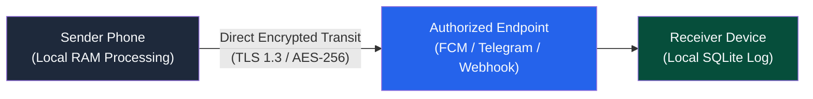

# 🛡️ Privacy, Security & Compliance Manual

**RelayMate** was engineered from the ground up to satisfy the strictest privacy regulations (GDPR, CCPA) and Google Play's Developer Program Policies regarding User Data and Restricted Permissions.

---

## 1. Zero-Server Architecture: Why Nothing is Stored

### The 4 Pillars of Zero-Server Privacy:
1. **No Developer Backend**: The developer operates **zero application servers, databases, or cloud buckets** that receive, inspect, or retain user messages.
2. **Ephemeral In-Flight Processing**: Notification interception and OTP extraction run exclusively in volatile memory (`RAM`). The moment the packet is handed to the network interface, the in-memory buffer is released.
3. **Local-Only Storage**: The 200-message history log is stored strictly on the physical device inside Android's sandboxed `SharedPreferences` / internal storage.
4. **Zero-Knowledge Encryption**: With client-side AES-256-GCM, the encryption key is transferred directly screen-to-camera via QR code. Intermediary cloud conduits (such as Google FCM) cannot inspect the ciphertext.

---

## 2. Google Play SMS & Call Log Policy Compliance

Google Play strictly restricts apps requesting `READ_SMS`, `RECEIVE_SMS`, `SEND_SMS`, and `READ_CALL_LOG` to default handlers only.

### How RelayMate Achieves 100% Policy Compliance:
* **Zero Restricted Permissions**: All telephony and SMS permissions have been completely purged from `AndroidManifest.xml`.
* **Sanctioned Android Notification APIs**: Message interception uses `android.service.notification.NotificationListenerService`. Under Google Play Policy, notification access is fully permitted for communication aids, productivity utilities, and notification management apps.
* **No Declaration Forms Needed**: You do **not** need to file an SMS/Call Log Permissions Declaration Form in Google Play Console. This eliminates the #1 cause of rejection for message utility apps.

---

## 3. GDPR & CCPA Compliance

| Requirement | How RelayMate Complies |
| :--- | :--- |
| **Right to Access (GDPR Art. 15)** | All logged data is visible directly in the in-app **Message Log** screen. Users can export their complete log to a CSV spreadsheet with one tap. |
| **Right to Erasure (GDPR Art. 17)** | Tapping **"Clear Log"** instantly and permanently deletes all recorded entries from local storage. Uninstalling wipes all app data permanently. |
| **Data Minimization (GDPR Art. 5)** | The app collects only what is strictly necessary to forward notifications. Zero location data, device identifiers, advertising IDs, or telemetry are collected. |
| **No "Sale" of Personal Information (CCPA)** | RelayMate never sells, rents, monetizes, or shares user data with third-party data brokers or advertising networks. |

---

## 4. Android Permissions Justifications

| Permission | Technical Need | User Justification |
| :--- | :--- | :--- |
| `BIND_NOTIFICATION_LISTENER_SERVICE` | Required by Android OS to capture notification events. | Enables reading incoming SMS, RCS, and missed calls so they can be relayed. |
| `POST_NOTIFICATIONS` | Required on Android 13+ (API 33+) to post status and incoming push notifications. | Displays incoming messages and interactive `[📋 Copy OTP]` banners on the receiver phone. |
| `FOREGROUND_SERVICE_DATA_SYNC` | Keeps the persistent background watchdog active. | Prevents Android's OEM battery savers from killing the forwarder on low-RAM devices. |
| `RECEIVE_BOOT_COMPLETED` | System broadcast receiver on device startup. | Automatically restarts message forwarding when the phone reboots. |
| `INTERNET` | Standard socket & HTTP connections. | Required to transmit encrypted messages over data/Wi-Fi to your paired device. |
| `CAMERA` | Camera access for barcode scanning. | Used solely to scan the pairing QR code between your two devices. |
| `USE_BIOMETRIC` | BiometricPrompt authentication. | Locks the app and message history behind Fingerprint, Face ID, or system PIN. |

