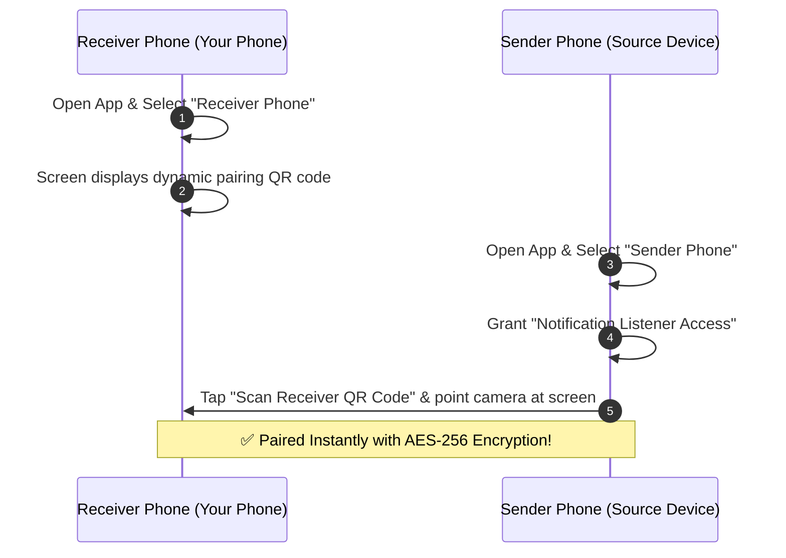

# 📖 User Manual & Feature Guide

**RelayMate** enables instant, private, cross-device message forwarding. This guide walks you through pairing, everyday usage, and family care features.

---

## ⚡ 2-Second Setup & Pairing

You will need both phones connected to the internet (Wi-Fi or Mobile Data).

### Step 1: On Your Phone (Receiver / Target)
1. Install and open **RelayMate**.
2. Select **Receiver Phone (Target)** at the top.
3. The app will generate a secure QR code containing your device's pairing token and a unique 256-bit encryption key.

### Step 2: On the Sender Phone (Source Device)
1. Install and open **RelayMate**.
2. Select **Sender Phone (Source)**.
3. Tap **Enable** under *Required Permission* $\rightarrow$ Grant **Notification Access** to RelayMate.
4. Tap **"Scan Receiver QR Code"** and point the camera at your phone's screen.
5. The device will beep and confirm: *"✅ Paired with Receiver (E2EE Active)"*.

---

## 👵 Senior-Proof Screen Lock

Designed specifically for elderly relatives or non-technical family members to prevent accidental tampering:

1. After pairing the Sender phone, scroll down and tap **"👵 Senior-Proof Screen Lock"**.
2. The entire technical interface (switches, tokens, webhooks, logs) will vanish.
3. The screen transforms into a simple, calming status card:
   > **🛡️ Protection Active**  
   > *"Your messages, bank alerts, and OTPs are safely shared with your family. Everything is working in the background. You do not need to do anything here."*
4. **How to Unlock**: Tap **"⚙️ Unlock Settings"** $\rightarrow$ authenticate via Fingerprint, Face Unlock, or system PIN to restore the configuration dashboard.

---

## 🔊 Remote Phone Finder (Emergency Ringer)

If a family member misplaces their phone between sofa cushions or in another room on **Silent Mode**:

1. Open RelayMate on your phone (Receiver mode).
2. Scroll to the **"🔔 REMOTE PHONE FINDER"** card.
3. Tap **"🔊 Ring Sender Device"**.
4. The Sender phone will immediately sound an audible chime at **maximum volume for 30 seconds**, even if the physical phone is in Silent, Vibrate, or Do Not Disturb mode.

---

## 💻 Local Desktop Web Companion (Browser View with Desktop Push & Sound)

View incoming OTPs and messages live on your PC, Mac, or iPad browser without touching your phone:

1. On your Receiver phone, scroll to **"💻 Desktop Web Companion"**.
2. Toggle the switch **ON**.
3. The app will display your local address, e.g.:
   `Open http://192.168.1.15:8080 on PC/Mac (PIN: 1234)`
4. Open Chrome, Safari, or Edge on your computer and visit the URL.
5. Enter the 4-digit PIN (default: `1234`).
6. Tap **"⚡ Enable Desktop Alerts"** to grant browser notification permission.
7. **Native OS Push & Synthesized Chime**: Incoming messages trigger native desktop notifications (macOS Notification Center / Windows Action Center) and a crisp synthesized dual-tone audio chime (via Web Audio API) even if the browser tab is minimized or running in the background.
8. Click the desktop push banner to automatically focus the browser window and copy the OTP!

> [!NOTE]
> Your phone and laptop must be connected to the **same home Wi-Fi router**. Traffic is 100% local and never leaves your home network.

---

## 📋 Smart OTP 1-Tap Copy & Auto-Copy (Zero-Tap with 60s Auto-Clear)

When a bank verification code, delivery PIN, or login OTP arrives:
* **Interactive 1-Tap Copy**: The notification includes an interactive button: **`[📋 Copy OTP: 849201]`**. Tap it to copy directly to your clipboard.
* **Auto-Copy to Clipboard (Zero-Tap Option)**: In Receiver Mode, enable **"📋 Auto-Copy OTP on Arrival"**. RelayMate will automatically place incoming OTP codes directly onto your clipboard the moment the push notification arrives—no tapping required.
* **⏱️ 60-Second Auto-Clear Security Timer**: To prevent malicious background applications from harvesting banking codes from your clipboard history, RelayMate automatically purges the copied OTP code after 60 seconds.
* **Security Guard**: On Android 13+ (API 33+), OTP clipboard writes are masked with `ClipDescription.EXTRA_IS_SENSITIVE` to block shoulder surfing and on-screen previews.

---

## ⌚ Wear OS & Smartwatch Optimization

For users with a Galaxy Watch, Pixel Watch, or Wear OS smartwatch:
* Time-sensitive OTP notifications route through a high-priority channel featuring a distinctive urgent double-pulse vibration cadence (`0, 200, 100, 200, 100, 250`).
* Utilizing `NotificationCompat.WearableExtender()`, the primary action on your wrist is a large, readable **`[📋 Copy OTP]`** button so you can confirm or copy verification codes directly from your smartwatch.

---

## 🏷️ Sender Device Nickname / Custom Origin Tag

When monitoring multiple devices (e.g. Dad's phone, Mom's phone, or a secondary work device):
1. In Sender Mode, tap **"🏷️ Device Nickname: (Tap to set)"**.
2. Assign a friendly label such as `Dad's Phone` or `Work SIM`.
3. All outgoing messages across FCM push, Telegram, and Webhooks will be prefixed with:
   `[Dad's Phone • SIM 1] HDFCBK: Your OTP is 849201...`

---

## 🌙 Scheduled Active Hours & Quiet Hours (DND Mode)

Mute automated forwarding during sleep or off-hours without disabling the forwarder completely:
1. Under *Smart Rules & Privacy*, tap **"🌙 Quiet Hours (DND)"**.
2. Set your quiet window in 24-hour format (e.g. `22:00` to `07:00`). Crossovers across midnight are automatically handled.
3. **Smart OTP Exemption**: Leave *"Always forward bank alerts & OTPs"* checked so urgent 2FA codes pierce through quiet hours while casual promotional chatter is silenced.

---

## 👥 Multi-Receiver Hub (Manage Up to 3 Receivers)

Forward one sender device to multiple target devices simultaneously (e.g. primary phone + secondary phone + family member):
1. Tap **"👥 Receivers (X/3)"** under *Relay Status & Pairing*.
2. View all active receivers, their token fingerprints, and registration dates.
3. Tap any receiver to **Rename**, send an instant **🧪 Test Ping**, or **🗑️ Remove / Unpair**.

---

## 🔤 Advanced Regex Filter Matcher

For power users who need granular control over which messages forward:
1. Under *Smart Rules & Privacy*, tap **"🔤 Custom Regex Filter"**.
2. Enable the regex matcher and enter any standard Java/Kotlin regular expression, such as:
   * `(?i)(salary|credited|refund|otp)` (Only forward salary, credits, refunds, and OTPs)
   * `(?i)(hdfc|sbi|icici|axis)` (Only forward major bank communications)
3. Messages that fail to match the expression are safely silenced.

---

## 🩺 System Health Diagnostic Dashboard

If messages ever appear delayed or forwarding drops:
1. Under *Diagnostics & Maintenance*, tap **"🩺 Health Check"**.
2. Runs an instant audit of 7 critical subsystems:
   * 🟢 **Network**: Online vs Offline Retry Queue
   * 🟢 **Notification Access**: Granted vs Revoked
   * 🟢 **OEM Battery Optimization**: Whitelisted (Unrestricted) vs Optimized
   * 🟢 **FCM Push Engine**: Device token registered
   * 🟢 **Companion Receivers**: Receiver count and connection state
   * 🟢 **Relay Watchdog**: Background service alive
   * 🟢 **Quiet Hours**: Current DND status
3. Provides 1-tap resolution buttons for any identified warning.

---

## 🧪 Rule Sandbox & Inbound SMS Simulator

Test your whitelist, spam keywords, regex patterns, and quiet hour rules without waiting for a real SMS:
1. Under *Diagnostics & Maintenance*, tap **"🧪 Rule Simulator"**.
2. Enter a mock sender (e.g. `VM-HDFCBK`) and message body.
3. Tap **"Run Simulation"** to view a live step-by-step evaluation showing Whitelist match, Spam filter check, Regex match, DND evaluation, extracted OTP, and parsed bank balances.

---

## 🔒 Message History Retention & Zero-Disk Privacy Mode

Configure how long forwarded messages remain stored on device storage:
1. Open **📋 History Logs** $\rightarrow$ tap **"🔒 Retention"**.
2. Choose from 4 privacy modes:
   * **Rolling 200 Messages (Default)**: Keeps the last 200 forwarded alerts.
   * **Auto-Purge after 24 Hours**: Automatically clears messages older than 1 day.
   * **Auto-Purge after 7 Days**: Retains only the active week's audit trail.
   * **Zero-Disk Privacy Mode**: Relays messages purely in RAM—never writes message bodies or OTPs to flash storage.
3. Filter logs in real-time with the instant search bar or filter chips (`[All]`, `[🔑 OTPs Only]`, `[✅ Forwarded]`, `[❌ Failed]`).

---

## 💳 Family Bank Balances Widget

When a bank debit/credit alert arrives on the Sender phone (HDFC, SBI, ICICI, Axis, Chase, Citi, etc.):
* The app automatically extracts the available balance on-device.
* The Receiver phone displays the latest known balances under **"💳 FAMILY BANK BALANCES"**, giving you instant visibility into whether accounts need attention.

---

## 📤 Exporting Message Logs to CSV / Excel

1. Tap **📋 Logs** from the main dashboard.
2. Tap the three-dot menu $\rightarrow$ Select **"📤 Export CSV"**.
3. Choose your preferred app (Google Drive, Gmail, WhatsApp, Excel, AirDrop) to export a formatted spreadsheet:
   `Timestamp, Sender, Type, Status, Message Body`

---

## ⚡ Quick Settings Notification Shade Tile

Pause or resume message forwarding instantly with 1 tap:
1. Swipe down from the top of your screen to open Android's **Quick Settings** panel.
2. Tap the pencil/edit icon to customize your tiles.
3. Locate **RelayMate** and drag it into your active tiles.
4. Tap the tile at any time to toggle between **"Active"** and **"Paused"** without launching the app.

---

## 📱 Home Screen Glance Widget

Add a glanceable, interactive RelayMate widget directly on your Android launcher:
1. Long-press on any empty spot on your home screen and select **Widgets**.
2. Search for **RelayMate** and place the 4x1 or 2x2 widget.
3. The widget provides:
   * **Real-Time Relay Status**: Shows whether forwarding is active or paused, with a 1-tap **`[🟢 Active / ⏸️ Paused]`** toggle button.
   * **Today's Forwarded Message Counter**: Real-time tally of messages relayed today.
   * **Latest Received OTP with 1-Tap Copy**: Highlights the newest extracted OTP code with a dedicated **`[📋 Copy]`** button directly from your launcher.

---

## 🔋 Remote Sender Low Battery & Power-Loss Alerts

Never get stranded because the unattended sender phone silently ran out of battery:
* **Low Battery Alert ($\le 15\%$)**: Dispatches a high-priority push notification to the receiver device (`⚠️ Low Battery Warning: Sender device is at 12%. Connect charger to maintain forwarding.`).
* **Power Disconnect Warning**: If the charger is unplugged while battery is below $25\%$, an urgent alert is relayed to ensure the device is plugged back in.
* **Smart Cooldown**: Alerts are throttled (4 hours for low battery, 1 hour for disconnect) to prevent notification spam.

---

## 📶 Wi-Fi Only Forwarding (Data Saver Mode)

For secondary sender devices operating on budget or pay-per-MB cellular data plans:
1. In Sender Mode, enable **"📶 Wi-Fi Only Mode"**.
2. When the phone is disconnected from Wi-Fi, all incoming messages and webhooks are automatically held in the local memory retry queue.
3. As soon as the sender phone connects to home or office Wi-Fi, the queue automatically flushes and delivers all pending alerts without consuming mobile data.

---

## 📡 On-Demand Remote Device Telemetry Ping

Want to check if the remote sender phone is still plugged in and connected?
1. On the Receiver phone, tap **"📡 Ping Status"** under Remote Actions.
2. The sender device responds within 1 to 2 seconds with its live telemetry:
   * **Battery Level & Charging State**: Current percentage and charging source (AC / USB / Wireless / On Battery).
   * **Network Status**: Whether connected to home Wi-Fi or cellular mobile data.
   * **Relay Watchdog Health**: Confirms the background forwarder service is active.
   * **Today's Forward Counter**: Total messages forwarded so far today.

---

## 📊 Scheduled 8:00 PM Daily Summary Digest

Receive an evening briefing consolidating your remote device's daily activity:
* In Sender Mode, enable **"📊 8:00 PM Daily Summary"**.
* Every evening at 8:00 PM, RelayMate compiles and relays an activity report across all active channels:
  > *📊 8:00 PM Daily Summary (Dad's Phone):*
  > *• Relayed Today: 12 messages*
  > *• OTPs Received: 6*
  > *• Bank Alerts: 3*
  > *• Missed Calls: 1*
  > *• Battery: 88%*

---

## 🔄 Configuration Backup & Device Migration

Easily migrate your channel configurations (Telegram bot tokens, Discord/Slack webhooks, keyword filters) to a new phone:
1. Open **Connected Channels** from the main dashboard.
2. Scroll to the **"🔄 Backup & Device Migration"** card.
3. Tap **"📤 Export Backup"**: Your complete configuration is copied to your clipboard and opened in the Android Share Sheet.
4. On your new phone, open **Connected Channels** $\rightarrow$ tap **"📥 Import Backup"** $\rightarrow$ paste the backup JSON $\rightarrow$ tap **Restore**. All channels and settings will be restored instantly!

---

## 🚀 Dynamic App Launcher Shortcuts

Access your primary actions instantly without opening menus:
* Long-press the **RelayMate** application icon on your Android home screen launcher.
* Three instant shortcuts are available:
  1. **🔑 Latest OTP**: Immediately copies the most recent authentication code to your clipboard and displays an on-screen toast.
  2. **⚡ Toggle Relay**: Instantly pauses or resumes the background forwarding watchdog.
  3. **🩺 Diagnostics**: Directly launches the 7-point System Health & Diagnostic inspector.

---

## 🛡️ Smart Channel Routing Matrix (Content-Aware Privacy)

Keep your financial and identity credentials separated from shared office or group channels:
* In Sender Mode, navigate to **Smart Channel Routing** and enable **"🛡️ Route OTPs to Encrypted FCM Only"**.
* When enabled, sensitive authentication codes and bank OTPs will **only** be forwarded through the end-to-end encrypted direct FCM channel to your paired device.
* Public and collaborative channels—such as Discord server channels, Slack workspaces, Telegram groups, and SMTP email—are automatically bypassed for OTP payloads, preventing coworkers or group members from seeing private 2FA codes.

---

## 📞 Live Ringing Call Alerts ("Phone is Ringing!")

Never miss a phone call when your secondary or elderly relative's phone is located in another room:
* In Sender Mode, enable **"📞 Forward Live Ringing Calls"**.
* RelayMate intercepts active incoming call notifications from the system dialer in real time (`msgType = "RINGING"`).
* An instant heads-up alert is dispatched to your companion phone *while the phone is still ringing*—giving you time to answer or alert your family member before the call is missed.
* Built-in 30-second deduplication prevents notification spam from repeated dialer ring pulses.

---

## ⏳ Ephemeral OTP Auto-Dismiss (5-Minute Expiry)

Keep your notification shade clean and clutter-free automatically:
* In Receiver Mode, enable **"⏳ Ephemeral OTPs (Auto-Dismiss after 5m)"**.
* Standard OTPs and two-factor authentication codes generally expire after 3 to 5 minutes.
* RelayMate uses Android's native `setTimeoutAfter(300000L)` and background cancellation timers to cleanly remove expired OTP notifications from your shade after 5 minutes, eliminating the need to swipe them away manually.

---

## 🚨 Emergency SOS Trigger Keywords (Family Safety)

Instant audible alerting for life-safety messages:
* In Sender Mode, enable **"🚨 Emergency SOS Keywords"**.
* When an incoming text contains distress words (e.g., `HELP`, `SOS`, `EMERGENCY`, `FALL`, `ACCIDENT`), RelayMate immediately marks the alert as `EMERGENCY_ALERT`.
* **Quiet Hours Bypass**: Even if Quiet Hours (DND) are active, emergency messages are never suppressed.
* **Audible Alarm on Receiver**: The receiver device plays an audible alert for 10 seconds to awaken and notify family members immediately.

---

## 🛡️ Biometric App Lock on Receiver (Privacy Guard)

Protect historical financial and authentication logs:
* In Settings, toggle **"🔒 Biometric Lock"** ON.
* Whenever the user attempts to view historical message logs or reveal cryptographic keys, Android prompts for Fingerprint, Face Unlock, or Device PIN.
* Unauthenticated users or shoulder surfers cannot access sensitive OTP logs or banking transactions.

---

## 📴 Contact / Sender Whitelist & Blacklist

Take fine-grained control over which senders are forwarded:
* In Sender Mode, tap **"📴 Sender Filter (Config)"**.
* Three modes are available:
  1. **Forward All Senders (Default)**: Normal operation, forwards all incoming SMS and RCS.
  2. **Whitelist Mode**: Only forwards messages from specified sender headers or numbers (e.g. `HDFCBK, SBI, Mom, +15551234567`). All other senders are silently ignored.
  3. **Blacklist Mode**: Blocks known marketing, loan, or betting spam numbers while relaying everything else.

---

## 🍎 iPhone Receiver Companion (`ios-receiver/`)

Use your Apple iPhone as the primary receiver device:
1. Open the `ios-receiver` project in Xcode and run it on your iPhone.
2. The iPhone displays its dynamic pairing QR code with a 256-bit AES encryption key.
3. Open RelayMate on your secondary Android phone (Sender Mode) $\rightarrow$ scan your iPhone's screen.
4. Incoming text messages and OTPs are forwarded via APNs/FCM directly to your iPhone lock screen with client-side decryption and 1-tap **`[📋 Copy OTP]`** actions.

---

## 🔄 Hybrid / Dual-Role Mode (Sender + Receiver on 1 Mobile)

If you need a single Android device to **both forward its own SIM messages AND receive alerts from another family member's phone**:
1. At the top of the main dashboard, select **"Hybrid (Both)"**.
2. **Dual-Role Execution**:
   - **Sender Engine**: Actively intercepts your local SIM cards' SMS, RCS, and call notifications, relaying them outward to your Telegram, Discord, Slack, or Web Companion.
   - **Receiver Engine**: Displays your device's dynamic pairing QR code and remains actively listening for incoming encrypted pushes from other family members' phones.
3. **Echo-Proof Protection**: Built-in self-package suppression ensures that notifications received from other phones are never re-forwarded in an infinite loop.

---

## 🎯 1-Tap Configuration Presets (Quick Profiles)

Get up and running in 1 second with pre-tuned profiles designed for your specific use case:
* **🏦 Banking & 2FA Only**:
  * For users who only want critical OTPs without chat noise.
  * Enables: Forward OTP Only, Route OTP to FCM Only, 60s Clipboard Auto-Clear, Zero-Tap Auto-Copy, and 5-Min Ephemeral Auto-Dismiss.
  * Disables: Call alerts and general SMS forwarding.
* **👴 Senior Care**:
  * For setting up an elderly parent's or grandparent's phone.
  * Enables: Live Ringing Calls, Missed Calls, Low Battery Remote Alert, Emergency SOS, Low Storage Watchdog, SIM Swap Alert, and Biometric / Senior-Proof Lock.
* **💼 Dual-SIM Work**:
  * For managing a second work phone alongside your personal mobile.
  * Enables: Work Phone nickname badge, Live Ringing Calls, Missed Calls, and Scheduled Quiet Hours (7:00 PM to 8:00 AM) with urgent OTP exemptions.

---

## 💾 Low Storage Watchdog ("Storage Almost Full!")

Prevent Android OS from aggressively terminating background forwarding services due to full disk storage:
* Toggle **"💾 Low Storage Watchdog"** ON in Enrichment Rules.
* The watchdog checks internal storage using Linux `StatFs`.
* If free internal space falls below **500 MB**, it dispatches an urgent warning to all companion receivers:
  > *"⚠️ Low Storage Warning: Only 340MB remaining on Dad's Phone. RelayMate and background services may be stopped by Android if storage is critically low. Please free up space."*
* Includes a **12-hour anti-spam cooldown** to avoid spamming the companion phone while warning is acknowledged.

---

## 📴 SIM Card Swap & Removal Security Alert

Detect physical device tampering or accidental SIM dislodging:
* Toggle **"📴 SIM Swap & Removal Alert"** ON in Enrichment Rules.
* Listens directly for the system broadcast `android.intent.action.SIM_STATE_CHANGED`.
* If a SIM card is physically ejected or changed (`simState == "ABSENT"`), an immediate high-priority security alert is sent:
  > *"🚨 SIM Card Alert (Sender Phone): The SIM card was removed or unseated from this device! Verify physical device security immediately."*
* Requires zero telephony permissions and includes a 1-hour anti-spam cooldown.

---

## 🔕 Remote Ringer Silencer (Mute Phone from Companion)

Remotely silence an unattended sender phone without needing dangerous system DND policy permissions:
* On your companion Receiver phone (under Remote Phone Actions), tap **"🔕 Silence"**.
* A secure FCM command (`type = "REMOTE_MUTE"`) is dispatched to the sender phone.
* The sender phone immediately sets its ringer and notification stream volumes to 0 and switches to Vibrate mode.
* You receive an instant confirmation: *"🔕 Sender phone silenced!"*.

---

## 🔋 OEM Battery Optimization Checklist (Crucial for 24/7 Reliability)

Some manufacturers (Samsung, Xiaomi, Oppo, OnePlus) aggressively kill background processes. To ensure uninterrupted forwarding on the Sender phone:

* **Samsung**: Settings $\rightarrow$ Apps $\rightarrow$ RelayMate $\rightarrow$ Battery $\rightarrow$ Select **Unrestricted**.
* **Xiaomi / Redmi**: Settings $\rightarrow$ Apps $\rightarrow$ Manage Apps $\rightarrow$ RelayMate $\rightarrow$ Enable **Autostart** $\rightarrow$ Battery Saver $\rightarrow$ **No Restrictions**.
* **OnePlus / Oppo / Realme**: Settings $\rightarrow$ Battery $\rightarrow$ More Settings $\rightarrow$ App Battery Management $\rightarrow$ RelayMate $\rightarrow$ Enable **Allow background activity** & **Allow auto-launch**.

